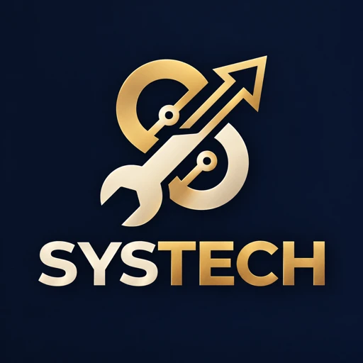

<p align="center">
  
</p>

<h1 align="center">SYSTECH Studio</h1>

<p align="center">
  <a href="LICENSE"></a>
  <a href="CHANGELOG.md"></a>
  
</p>

<p align="center">
  Interfaz web para crear, <b>verificar dos veces</b> y entregar backends .NET con un agente de IA.<br>
  Funciona con Claude Code y con tu propia clave de API. Gratis y de código abierto.
</p>

---

## Qué hace

1. **Cargás un pedido** en texto y, si querés, el proyecto en `.zip` y documentos de referencia.
2. **El agente** genera o modifica el código.
3. **Verificación 1 (automática):** compila, corre los tests, busca paquetes vulnerables y secretos en el código. Si lo activás, también corre una prueba de humo con Docker.
4. **Verificación 2 (independiente):** el `.zip` se compila y se testea desde cero en una carpeta limpia. Después lo audita un **segundo agente de solo lectura** que no vio cómo se generó el código.
5. **Si algo falla**, el agente corrige solo y se repiten **las dos** verificaciones.
6. **Revisás y entregás** un `.zip` firmado, con los informes de verificación y las huellas SHA-256, o lo subís a una rama de GitHub.

Corre en tu propio GitHub Codespace y es para un solo usuario: vos.

## Antes de usarlo

- **Tu clave, tu gasto.** Cada persona usa su propia API key de Anthropic, o su suscripción de Claude. Configurá un **tope de gasto mensual** en la consola de Anthropic. El Studio agrega además un tope por cada ejecución del agente (`STUDIO_MAX_BUDGET_USD`, US$ 5 por defecto).
- **Ejecuta código.** El Studio compila y corre los tests del proyecto que procesa, y eso significa ejecutar código de terceros dentro de tu Codespace. **Usalo solo con proyectos en los que confíes.**
- **El puerto siempre en Private.** El Studio no tiene usuarios ni contraseñas propios: lo protege el reenvío de puertos de Codespaces en modo **Private**, que exige tu sesión de GitHub. Nunca lo pases a *Public*.
- **Sin garantía.** Se entrega "tal cual", sin garantías de ningún tipo (ver [LICENSE](LICENSE)). Revisá siempre lo que entregás: la responsabilidad final es tuya.
- **Privacidad.** El Studio **no tiene telemetría** y no envía datos a Systech Soluciones ni a ningún otro servidor. Tus pedidos y tu código solo van a tu Codespace y al proveedor del modelo que configures. Las tipografías vienen incluidas, así que la interfaz no carga nada de internet. Claude Code tiene su propia configuración de privacidad, que podés revisar en su documentación.

## Instalación (GitHub Codespaces)

1. **Hacé un fork** de este repositorio (o usalo directo si es tuyo).
2. **Cargá tu API key como secreto** (una sola vez):
   - En GitHub: foto de perfil → **Settings** → **Codespaces** → **New secret**.
   - Nombre: `ANTHROPIC_API_KEY`. Valor: tu clave (la creás en [platform.claude.com/settings/keys](https://platform.claude.com/settings/keys)).
   - En **Repository access**, elegí tu copia de este repositorio.

   Si preferís usar tu suscripción de Claude, saltá este paso y ejecutá `claude` una vez en la terminal para iniciar sesión.
3. **Creá el Codespace:** botón verde **Code** → **Codespaces** → **Create codespace on main**. El `.devcontainer` instala todo solo: Node.js, .NET 10 (LTS), Docker, las dependencias y Claude Code. Si no cargaste el secreto antes, GitHub te lo pide al crearlo.
4. **Prendé el Studio** en la terminal del Codespace:
   ```bash
   bash scripts/start.sh --demo   # agente simulado: no gasta nada, ideal para conocerlo
   bash scripts/start.sh          # agente real
   ```
5. **Abrilo:** pestaña **PORTS** → puerto **5080** → ícono del globo. Verificá que la visibilidad diga **Private**.

El panel **Entorno** de la barra lateral muestra si el agente, la autenticación, .NET y Docker están listos.

> **Nunca** pegues la API key en un archivo, en un pedido o en el chat del agente. Va solo como secreto de Codespaces.

### Uso diario

- **Apagarlo:** `Ctrl + C` en la terminal donde corre.
- **Si el Codespace se durmió:** abrilo de nuevo y ejecutá `bash scripts/start.sh`. Los trabajos se guardan en `~/systech-jobs`. Los que quedaron a medias aparecen como *Interrumpido*: abrilos y tocá **Reintentar verificación**.
- **Manual completo:** [`docs/manual.html`](docs/manual.html). Descargalo y abrilo con doble clic; funciona sin internet.

## Cómo funciona la doble verificación

| | Qué hace | Responde |
|---|---|---|
| **1 · Automática** | `dotnet build`, `dotnet test`, `dotnet list package --vulnerable`, búsqueda de secretos y, si la activás, una prueba de humo con Docker. | ¿Funciona? |
| **2 · Independiente** | Compila y testea el `.zip` desde cero. Después un segundo agente de solo lectura lo revisa contra el pedido: requisitos, casos borde, seguridad y calidad. | ¿Es lo que se pidió, y está bien hecho? |

Qué bloquea la entrega y qué no:
- Bloquean: los errores de compilación, los tests que fallan, las vulnerabilidades altas o críticas, los secretos en el código, los hallazgos críticos o altos del revisor y los requisitos faltantes.
- No bloquean: las sugerencias medias y bajas. Se informan, pero la entrega sigue.
- Si se acaban los intentos (los elegís, de 1 a 5), los errores quedan en el **Taller**. Cada uno tiene un botón **Corregir con el agente**.

## La entrega firmada

El `.zip` incluye:

- el código y los tests (sin `.env`, `bin/`, `obj/`, `.git/` ni certificados);
- `ENTREGA.md`, `verificacion.md` y `revision-independiente.md`, cada uno terminado en:
  `Verificado con SYSTECH Studio v1.1.1 — Systech Soluciones · <fecha> · Huella SHA-256 del contenido: <huella>`;
- `SHA256SUMS.txt`, con la huella de cada archivo. El cliente lo comprueba con `sha256sum -c SHA256SUMS.txt`.

La huella del `.zip` completo no puede ir adentro del propio `.zip`, así que va por fuera:

- se muestra en la pantalla de Entrega;
- se incluye en el informe que copiás para el cliente;
- se descarga como archivo `.sha256`.

El cliente la compara con `sha256sum archivo.zip` en Linux o macOS, o con `Get-FileHash archivo.zip` en Windows.

## Seguridad

- **Acceso.**
  - Escucha solo en `127.0.0.1`.
  - Responde solo a `localhost` y a `*.app.github.dev`, lo que lo protege del DNS rebinding.
  - Toda acción exige el encabezado `X-Studio` y no hay CORS, lo que lo protege del CSRF.
- **Navegador.** CSP estricta, sin nada inline y sin orígenes externos (`font-src 'self'`). Además `X-Frame-Options: DENY`, `nosniff` y `no-referrer`. La interfaz nunca inserta HTML que venga del servidor.
- **Archivos subidos.** Tienen límites de tamaño y de cantidad. Al descomprimir se bloquean el *zip slip* y el *zip bomb*, y se ignoran los enlaces simbólicos.
- **Procesos.**
  - Corren sin shell, con tiempo máximo y con cancelación de todo el árbol de procesos.
  - La compilación y los tests **no reciben ningún secreto**.
  - El agente recibe solo la API key.
  - Solo la subida a GitHub recibe el token.
- **Agente que construye.** Edita archivos y usa `dotnet`, sin internet y sin `git push`. Corre en modo `--restricted`, encerrado en la carpeta del trabajo.
- **Revisor.** Solo puede leer.

¿Encontraste un problema de seguridad? **No abras un issue:** seguí [SECURITY.md](SECURITY.md).

## Configuración (variables de entorno)

| Variable | Por defecto | Qué hace |
|---|---|---|
| `STUDIO_PORT` | `5080` | Puerto. |
| `STUDIO_DATA_DIR` | `~/systech-jobs` | Dónde se guardan los trabajos. |
| `STUDIO_CLAUDE_MODEL` | (el del CLI) | Modelo del agente, p. ej. `opus` o `sonnet`. |
| `STUDIO_MAX_BUDGET_USD` | `5` | Tope de gasto por ejecución del agente. `0` = sin tope. |
| `STUDIO_MAX_ATTEMPTS` | `3` | Intentos de corrección propuestos por defecto. |
| `STUDIO_AGENT_TIMEOUT_MIN` | `40` | Tiempo máximo de una ejecución del agente. |
| `STUDIO_BUILD_TIMEOUT_MIN` / `STUDIO_TEST_TIMEOUT_MIN` | `15` / `20` | Tiempo máximo de compilación y de tests. |
| `STUDIO_MAX_UPLOAD_MB` | `300` | Tamaño máximo de los archivos subidos. |
| `STUDIO_CLAUDE_RESTRICTED` | `1` | `0` desactiva `--restricted`. Usalo solo si tu versión del CLI no lo reconoce. |
| `STUDIO_ALLOWED_HOSTS` | — | Hosts extra permitidos, separados por coma. |

## Problemas comunes

- **"El agente no está autenticado"**: falta el secreto `ANTHROPIC_API_KEY` o la sesión de `claude`. Si cargaste el secreto con el Codespace ya creado, detenelo y volvé a abrirlo.
- **La prueba de humo no conecta entre contenedores**: después de reiniciar el Codespace, ejecutá `sudo iptables-legacy -P FORWARD ACCEPT`.
- **"unknown option"**: actualizá el CLI con `npm install -g @anthropic-ai/claude-code@latest`, o arrancá con `STUDIO_CLAUDE_RESTRICTED=0`.

## ¿Lo usás? Contanos en Discussions

Si SYSTECH Studio te sirve, contanos para qué lo usás en la pestaña **Discussions** del repositorio. Saber qué funciona y qué falta es lo que más nos ayuda a mejorarlo.

- ¿Encontraste un error? Abrí un **issue** con la plantilla "Reportar un error".
- ¿Tenés una idea? Usá "Proponer una mejora".

## Desarrollo

```bash
npm test        # pruebas: seguridad, zip, verificaciones, pipeline completo con agente simulado, servidor y firma
npm run demo    # Studio con el agente simulado
```

Estructura:

- `server.js`: HTTP y API.
- `src/jobs.js`: ciclo de cada trabajo.
- `src/checks.js`: verificación 1 y entorno limpio.
- `src/agent.js`: agente y revisor.
- `src/about.js`: versión, autoría y firma.
- `src/zip.js`, `src/secrets.js`, `src/github.js`: utilidades.
- `public/`: interfaz y tipografías.
- `prompts/`: instrucciones del agente y del revisor.

Para publicar una versión, creá un tag `vX.Y.Z` que coincida con `package.json`. El workflow `release.yml` corre las pruebas, arma `systech-studio-vX.Y.Z.zip`, calcula `SHA256SUMS.txt` y publica la Release.

## Licencia y marcas

[Apache License 2.0](LICENSE). Podés usarlo, modificarlo y redistribuirlo, también con fines comerciales. Al redistribuirlo tenés que conservar [LICENSE](LICENSE) y [NOTICE](NOTICE).

Las tipografías Sora, IBM Plex Sans y JetBrains Mono se distribuyen con la SIL Open Font License 1.1 (ver `public/fonts/`).

SYSTECH Studio funciona con Claude Code, pero no está afiliado a sus titulares ni cuenta con su respaldo. Claude y Claude Code son marcas de sus respectivos titulares.

---

<p align="center">
  Creado por <a href="https://www.linkedin.com/in/jos%C3%A9-antonio-vivas-rodriguez-0866843a7?ref=studio">José Antonio Vivas</a> · <b>Systech Soluciones</b>
</p>
